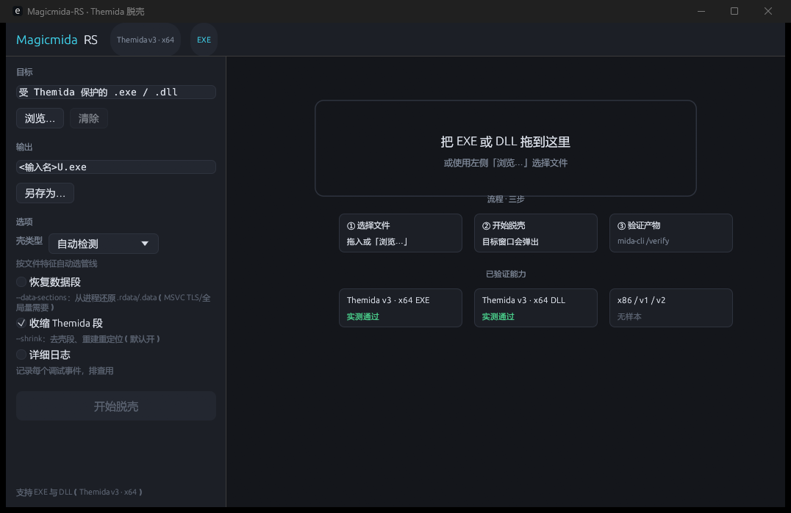
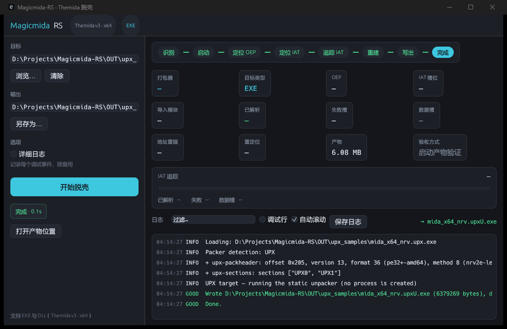

# Magicmida-RS

Themida unpacker and static packer analysis, Rust reimplementation.

Based on the reverse engineering of [Hendi48/Magicmida](https://github.com/Hendi48/Magicmida) (Pascal),
the entire unpacking pipeline is rewritten in Rust for safer memory management,
better error handling, and a modular architecture.

> ## Scope of this branch
>
> This repository is an **experimental sandbox** forked from the upstream project
> on 2026-07-09. It does not track upstream and does not represent upstream's
> capability.
>
> Everything below describes **what has actually been measured here**. Anything
> not verified is marked as such rather than advertised.

## Verified capability

All three rows are gated. Each gate asserts byte-level reproducibility *and*
observable behaviour, and each refuses to run unless the input matches the
SHA-256 recorded in `crates/packers/themida/tests/cases/`.

| Target | Status | Evidence |
|---|---|---|
| **Themida v3, x64, EXE** | ✅ Works | 186 resolved imports / 0 failed / 8 `not-an-import`; product launches to its `授权验证` window. Gate: `e2e_gate.rs` |
| **Themida v3, x64, DLL** | ✅ Works | 289 resolved / 0 failed / 3 `not-an-import`; product loads through a real `LoadLibraryW`, `GetAppVersion()` returns `"1.1"`, `Run()` reaches `PigToGoLicenseDialog`. Gate: `dll_e2e_gate.rs` |
| **Themida v3, x86, EXE** | ✅ Works | 55 resolved / 0 failed / 55 `not-an-import`; product's `MidaX86Sample` window appears in ~24 ms. Gate: `x86_e2e_gate.rs` |
| **VMProtect 3.x, x64, `MinProtection`** | ✅ Works | Identified with evidence; structure reported; payload extracted byte-exactly (`91d585e6…`) and decoded onward to a runnable PE (`e7004e89…`). At this mode the original code is already in the file, so there is nothing to rebuild. |
| **VMProtect 3.x, x64, `Packed`** | ✅ Works | Identified with evidence. Original sections are absent from the file, so `/dump-image --wait` captures them from a live process, flattens the image, and decodes the payload to a runnable PE (`e7004e89…`). |
| **VMProtect 3.x, x86** | ❓ No evidence | The detector is not architecture-specific, but only x64 targets have been measured. |
| Themida **v1 / v2** | ❓ No evidence | Detection code exists; never run on a real sample |

The 8 / 3 / 55 `not-an-import` slots are **not** failures. They hold bare RVAs
pointing into read-only data — exactly what the real Windows loader sees. They
are classified separately (`IatSlotDecision::NotAnImport`) so that a genuine
failure cannot hide inside "data".

**Byte-level reproducibility** (independent runs, whole-file SHA-256):

| Product | Size | SHA-256 |
|---|---|---|
| x64 EXE | 1,539,072 B | `af092f96…09b9fdd` |
| x64 DLL | 1,737,216 B | `97b9f20f…aa9f67` |
| x86 EXE | 110,592 B | `cf176ac9…5aa0d4` |

All three products declare `0x60000020` (read-only, executable) on their first
section — the same flags as their respective protected inputs.

Native `.dll` targets are loaded through a generated loader host
(`ensure_loader_host`) that calls the real `LoadLibraryW`, because a Themida DLL
shell expects the loader's `DLL_PROCESS_ATTACH` sequencing; the older "rewrite
the DLL into a stub EXE" approach bypassed it and the shell died at
`.winlice+0x33E22E`.

### VMProtect — identification, structure, live capture, payload decode

A **different** packer with a different shape, so it is a separate branch rather
than a Themida variant. It is **not a devirtualiser**: VMProtect's VM bytecode is
randomised per build and recovering the original x86 from it is deliberately out
of scope. What the branch does is everything deterministic — and none of it
attaches a debugger, so unlike `/unpack` these commands run headless.

| Capability | Command | Measured |
|---|---|---|
| Identify the packer, its mode, and the evidence | `/analyze` | `MEM_NOT_PAGED` on an executable section fires on the VMProtect samples and on **0 of 63** Themida samples, and **14 of 14** corpus samples classify correctly |
| Structure report | `/analyze` | runtime section, packed sections, virtualised-function stubs, scrambled `.pdata`, relocated exception directory |
| Extract a payload that is in the file | `/analyze --extract` | `伦伦软件.exe` → 16,102,969 B, sha256 `91d585e6…`, magic `XMP2QH_` |
| Capture a live image, flattened | `/dump-image <pid> <out> --wait` | 43,315,200 B, 9 sections all `PointerToRawData == VirtualAddress`; the dump's `.text` decodes 100.0% |
| Decode the payload to a runnable PE | both of the above | `14596cbd…` → `e7004e89…`, PE32+ x64, 9 sections, byte-exact |

Two modes are measured, and they need different pipelines:

| | `MinProtection` | `Packed` |
|---|---|---|
| sample | 19,005,952 B | 21,415,936 B |
| `.text` | present, decodes 100% | **`SizeOfRawData == 0`** — not in the file |
| entry point | inside `.text` | inside the runtime section |
| runtime section | `.vmp0` | `.rdata2` |
| payload | `RT_RCDATA` id 101, in the file | id 131, memory-only |
| produce | decoded payload | live capture → flat image → decoded payload |

Both states are backed by samples: the `Packed` state comes from a capture and
from a run of VMProtect's own packer, and the `MinProtection` state from **14
samples** built by a third party, which the CI gate walks on every run.

Three things worth knowing before trusting a verdict:

- **A name-based `.vmp0` check would miss `Packed` entirely** — its equivalent
  section is called `.rdata2`.
- Themida's own section heuristic (`raw_size == 0` + large virtual size) is
  satisfied by `Packed`'s `.rdata0` **and** by 6 genuine Themida samples, so it
  cannot be tightened into a VMProtect test. Before the packer gate existed,
  `/unpack` printed `Themida version: V3` for a VMProtect target and ran the
  whole Themida loop against it. The packer decision now runs first, carries its
  evidence, and refuses.
- **"Is any executable section empty?" is not the right question.** An
  uninitialised section (`.bss`, and VMProtect's own `.textbss`) is `raw_size 0`
  and executable in an entirely ordinary build; **12 of the 14 corpus samples
  have that shape**. The criterion is which sections *lost a body they would
  normally have*, and asking the wrong question classified a MinProtection
  sample as `Packed` until the corpus gate caught it.

`/dump-image` deliberately attaches **no debugger**: measured, the same sample
exits `0` bare and `0xDEADBEEF` under a debugger at about 7 s, with the debugger
as the only changed variable. It also samples until the payload stops changing,
because the container is rewritten in place after start-up — a dump taken too
early captures an intermediate state that looks plausible.

**Not claimed:**

- **Devirtualisation.** Not attempted; the VM bytecode is randomised per build.
- **The payload decode is per-family, not general.** `14596cbd…` → `e7004e89…` is
  a 32-byte repeating XOR recorded in an explicit table keyed by resource
  identity, derived from two independent artefacts. It is not a cipher break and
  it does not generalise to other VMProtect builds. The table's acceptance test
  is structural — the result must parse as a PE — so a wrong key is rejected
  rather than silently producing garbage.
- **The mode boundary rests on two shapes, not on a survey.** One vendor family
  plus a third-party corpus of 14 samples. The 14 are all `MinProtection`; only
  two `Packed` samples exist here.
- **`FullVirtualize` was not exercised.** It is a per-function option; producing
  such a sample needs VMProtect's project file, whose schema was not recovered.
- **x86 VMProtect targets are unmeasured.**

The full measurement tables are in [`docs/RUNBOOK.md`](docs/RUNBOOK.md).

## Features

- **Runtime IAT reconstruction** — resolves imports via live memory tracing, with
  a pure-function slot classifier (zero runs are separators, resolved blocks are
  adopted, VM pointers are traced, bare in-image RVAs are rebased)
- **OEP discovery** — MSVC CRT startup pattern matching, plus a guard path that
  works even when the image does not enforce DEP
- **ScyllaHide integration** — bypasses anti-debugging on newer Themida builds
- **PE rebuild** — import table, section table, exception table (`.pdata`), data
  directory repair, relocation table, ASLR
- **Packer identification with evidence** — a packer-neutral `Detection` that
  reports *why* a verdict was reached and records which markers were **absent**,
  so `likely_themida: false` is diagnosable instead of useless
- **VMProtect branch** — mode classification, structure report, in-file payload
  extraction, a debugger-free live image capture, and a measured payload decode
  to a runnable PE. Backed by a CI gate over 14 third-party samples
- **UPX branch** — detection, `PackHeader` parsing, a static layout report,
  and the **static unpacker**: `/unpack --packer upx` restores the original
  file with no process and no desktop session, byte-for-byte identical to
  `upx -d` on the corpus (NRV2B/NRV2D/NRV2E/LZMA decode through a shared
  UCL-core port, filter undo, full `unpack0` PE
  rebuild). Measured against UPX 5.2.1 output and cross-checked against UPX's
  own source. Two gates over a seven-sample corpus: the byte gate (products
  equal `upx -d` exactly) and a **behaviour gate** — every product is run
  and must answer `/version` exactly like its pre-pack control sample
  (corrupting the entry point in a product makes the gate fail with
  `0xC0000005`, so the assertion has teeth). Also fixes a real trap: UPX's
  `UPX0` section would otherwise fire the Themida heuristic and hand a UPX
  file to the Themida debugger loop
- **Verify mode** — diff unpacked output against a known-good reference,
  section by section
- **Guided mode** — running `mida-cli` with no arguments starts a beginner
  wizard (detect → explain → suggest one command → confirm → run), with
  "did you mean" suggestions on mistyped commands
- **GUI** — graphical front-end (`mida-gui.exe`): drag-and-drop with in-drag
  feedback, a beginner steps strip on the empty state, and a one-click
  打开产物位置 follow-up after a successful run
- **MCP server** — drive the pipeline from an AI client (`mida-mcp.exe`)

## Prerequisites

| Requirement | Notes |
|---|---|
| **Windows 10/11** | x64 host. The debugger core uses the Win32 Debug API; not cross-platform. |
| **Rust toolchain** | stable GNU target (`x86_64-pc-windows-gnu`). Install via [rustup](https://rustup.rs). |
| **ScyllaHide** (optional) | Required for Themida v3 targets with hardware-breakpoint detection. Download from [ScyllaHide Releases](https://github.com/x64dbg/ScyllaHide/releases). |
| **Interactive desktop session** | Only `/unpack` needs it — it injects ScyllaHide and the target creates its own windows. `/analyze`, `/dump-image`, `/verify` and the MCP `triage` tool are headless. |

## Quick Start

**New to unpacking? Just run the binary with no arguments:**

```bash
target/release/mida-cli.exe
```

That starts a **guided mode**: pick a file, the tool recognises the packer
(Themida / VMProtect / UPX), explains what it suggests and why, and runs one
command after your confirmation. A typo'd command gets a "did you mean" hint.
The wizard works piped as well, which is how it is smoke-tested:

```bash
printf 'protected.exe\n\nY\nn\n' | target/release/mida-cli.exe interactive
```

The GUI (`mida-gui.exe`) is the other beginner surface: drag an EXE/DLL onto
the window (the drop box reacts while you drag), press 开始脱壳, and a
打开产物位置 button appears next to the finishing status. The rail exposes the
CLI's real options — packer branch, `--data-sections`, `--shrink` — instead of
hiding them behind the log:





**Manual path:**

```bash
# 1. Build
cargo build --release

# 2. (Optional, Themida only) Place the ScyllaHide helpers next to the CLI.
#    VMProtect commands (/analyze, /dump-image) never inject anything and do
#    not need these.
cp HookLibraryx64.dll InjectorCLIx64.exe target/release/
cp crates/cli/assets/scylla_hide.ini target/release/   # the profile the packer selects at run time

# 3. Identify what you have (always start here)
target/release/mida-cli.exe /analyze "protected.exe"

# 4a. Themida target → unpack
target/release/mida-cli.exe /unpack "protected.exe"
# → writes protectedU.exe

# 4b. VMProtect target → see "Worked example" below
```

### Beginner FAQ

**The target's own windows just opened — is that a leak?**
No. `/unpack` on a live target runs the target under a debugger with
ScyllaHide injected; its windows are supposed to appear. Closing them aborts
the run. Only the Themida branch behaves this way — `/analyze` and the UPX
static unpack create no process at all.

**What do `resolved / failed / not-an-import` in the log mean?**
`resolved` slots now hold real imports; `failed` would be a problem;
`not-an-import` slots are *not* failures — they hold bare RVAs into read-only
data, exactly what the real Windows loader sees. They are classified
separately so a genuine failure cannot hide inside "data".

**Is the product byte-identical to the original file?**
For UPX: yes, against what `upx -d` produces (UPX rewrites the DOS-stub area
when packing and never restores it, so the pre-pack original is not a
meaningful ground truth). For Themida: the product is a reproducible golden
with behaviour gates (window appears, imports resolve), not a byte-equality
claim against the pre-pack file. See "Verified capability" above for the
evidence per target.

**Which packers are supported?**
Themida v3 (x64 EXE/DLL and x86 EXE, all gate-tested), VMProtect 3.x x64
(`MinProtection` and `Packed` modes), and UPX (static). Themida v1/v2 and
x86 VMProtect have no samples — detection code exists but nothing is claimed.

**The unpacked program starts but can't reach its server / licence check.**
Some targets validate against a remote module server; when that server is
unavailable, even the original protected sample fails the same way. Compare
against the original's behaviour before assuming the dump is broken.


### Building the x86 target

The x86 pipeline needs extra link-time setup that cannot be committed (it points
at absolute paths on the build machine). In short: point the `i686-pc-windows-gnu`
linker at an i686 GCC, supply a real `libgcc_eh.a`, and wrap the system import
libraries in `--start-group`. The full recipe is in
[`docs/RUNBOOK.md`](docs/RUNBOOK.md).

```bash
rustup target add i686-pc-windows-gnu
cargo build --release --target i686-pc-windows-gnu
```

### Worked example — a VMProtect target, end to end

Everything below ran against a real VMProtect 3.11 `Packed` sample. Start from
`/analyze` on any unknown file; it tells you which branch to use.

```text
> mida-cli /analyze target.exe
[GOOD] Packer: VMProtect (packed)
  + notpaged-executable-section: sections [".rdata2"]
  ...
  large resources     1:
    type 10 id 131 lang 0x409: 12782080 B (not in file — memory-only)
```

`Packed` means the original code is **not in the file** (`SizeOfRawData == 0`),
so there is nothing to extract statically — the refusal at the end of
`--extract` is the correct answer, and it names the command to use next.

**Step 1 — launch the target yourself, then note its PID.** The tool reads a
running process; it does not launch one, because attaching a debugger makes this
family self-terminate.

**Step 2 — capture the image, with `--wait`:**

```text
> mida-cli /dump-image 12345 image.exe --wait
[INFO] Image 'target.exe' loaded at 0x140000000 (preferred 0x140000000, ASLR delta 0 …)
[INFO]   .text   rva 0x001000 1224796 B read (0x12c000 raw), 0 page(s) unreadable
[INFO]   ...     9 section(s)
[INFO] Image settled after 3 sample(s) in 2.83s
[GOOD] Wrote 43315200 bytes to image.exe
[GOOD] Carved payload type 10 id 131 to image.rcdata131.bin (12782080 B, sha256 14596cbd…)
[GOOD] Decoded payload type 10 id 131 to image.rcdata131.decoded.exe (12782080 B, sha256 e7004e89…)
```

Three files come out:

| File | What it is |
|---|---|
| `image.exe` | The flattened live image (offset == RVA for all 9 sections). Feed this to a disassembler. |
| `image.rcdata131.bin` | The payload as the packer leaves it — still an encrypted container. |
| `image.rcdata131.decoded.exe` | **The runnable product.** PE32+ x64, 9 sections. |

**Step 3 — verify what you got** (optional but cheap):

```text
> mida-cli /analyze image.rcdata131.decoded.exe
Architecture: x64, 9 sections … Packer: (none of the known packers)
```

Three traps this workflow has already paid for:

1. **`--wait` is not optional.** The payload is rewritten in place after
   start-up; measured, it passes through about ten distinct states before
   settling at t≈1.65 s. Without `--wait` you can capture a half-decoded
   intermediate that looks completely plausible.
2. **This sample family registers a `RUNASADMIN` compatibility layer for its own
   path** the first time it runs — including a path it has never seen. An
   elevated process cannot be read from an unelevated one (`拒绝访问
   0x80070005`), so the *second* run from the same path always fails. Run the
   target from a fresh path, or clear the layer first:
   `reg delete "HKCU\Software\Microsoft\Windows NT\CurrentVersion\AppCompatFlags\Layers" /v "<full path>" /f`
3. **The whole-image hash is not stable.** Live images carry resolved pointers
   and the stack cookie, so three captures give three hashes. The payload hash is
   the golden; pin that, never the image.

## Usage

```
mida-cli                                  # guided mode (beginner-friendly)
mida-cli /unpack <filename> [options]
mida-cli /analyze <filename> [--extract <dir>]
mida-cli /dump-process <pid> <unpacked-file>
mida-cli /dump-image <pid> <output-file> [--wait]
mida-cli /verify <unpacked-file> <reference-file>
```

Only the Themida `/unpack` branch needs a desktop session. The other commands
read files or read a process's memory without attaching a debugger, so they
run headless — and `/unpack --packer upx` is fully static: no process, no
window, no desktop.

### `/unpack` — Unpack a Themida-protected executable

Launches the target under a debugger, waits for OEP, dumps memory, and rebuilds
the import table.

| Option | Description |
|---|---|
| `<filename>` | Path to the input executable (`.exe` or `.dll`). |
| `-o <path>` / `--output <path>` | Output path. Defaults to `<input>U.exe` (the "U" suffix convention from Pascal Magicmida). |
| `--data-sections` | Restore `.rdata` / `.data` sections from the target process. Needed for MSVC TLS callbacks and initialized global data. |
| `--shrink` | Remove Themida-specific sections (`.winlice` / `.boot` / `.themida`), compact VAs, clear dangling data directories, restore standard section names, build relocation table, and enable ASLR. **Enabled by default.** |
| `--no-shrink` | Disable shrinking. Keeps Themida sections and disables ASLR/relocation. Use for debugging or when shrink causes issues. |
| `-v` / `--verbose` | Enable debug-level logging. |
| `--packer auto｜themida｜vmprotect｜upx` | Which packer branch to take. `auto` (default) detects and refuses what the Themida pipeline cannot unpack. `themida` forces it (diagnostic override, logged). `vmprotect` selects the VMProtect branch, which uses its own ScyllaHide profile but shares the one debug loop that exists — experimental. `upx` runs the static unpacker (no process created). |

**Examples:**

```bash
# Basic unpack — output written to targetU.exe
mida-cli.exe /unpack target.exe

# Full rebuild with data sections and stub removal
mida-cli.exe /unpack target.exe --data-sections --shrink

# Specify output path, verbose logging
mida-cli.exe /unpack target.exe -o clean.exe -v
```

### `/dump-process` — Dump `.text` from a running process

A Themida-specific helper: reads the decrypted `.text` section from a live
process and writes it to a file. For a VMProtect target use `/dump-image`
instead — it captures the whole image and carves the payload, and `.text` is not
the interesting section there.

```bash
mida-cli.exe /dump-process 12345 unpacked_text.bin
```

### `/analyze` — Identify the packer and report its structure

Static analysis only: no debugger, no injection, no desktop session. Prints the
packer, its mode, the evidence behind the verdict, and the structure report.

```bash
mida-cli.exe /analyze target.exe
mida-cli.exe /analyze target.exe --extract payload_out/   # write in-file payloads
```

| Option | Description |
|---|---|
| `<filename>` | File to analyse. |
| `-x <dir>` / `--extract <dir>` | Write every payload that is present in the file, named `<stem>.rcdata<id>.<ext>`, plus `<stem>.rcdata<id>.decoded.exe` when a measured decode exists for that resource. Fails when nothing is extractable rather than silently writing nothing. |
| `-v` / `--verbose` | Enable debug-level logging. |

It answers for both supported packers: for a Themida target it prints the
Themida sections and points at `/unpack`; when nothing matches it names the
markers it looked for.

### `/dump-image` — Flatten a running process's loaded image

For a `Packed` VMProtect target the original sections are not in the file at all
(`SizeOfRawData == 0`), so the image has to be read from a live process. This
reads it **without** attaching a debugger — measured, attaching one makes that
sample exit `0xDEADBEEF` at about 7 s while a bare run exits `0`.

```bash
mida-cli.exe /dump-image 12345 image.exe --wait
```

| Option | Description |
|---|---|
| `<pid>` | PID of a running instance of the target. |
| `<output>` | Where to write the flat image. |
| `-w` / `--wait` | Keep sampling until the image stops changing, then write it. **Recommended for `Packed` targets:** their payload is rewritten in place after start-up, so a single immediate read can capture a half-decoded intermediate. Measured, the resource region passes through about ten distinct states before settling at t≈1.65 s. |

The output is a **flat image**: file offset equals RVA for every section, headers
at offset 0. That is the shape a disassembler wants, and it keeps every
data-directory RVA resolvable. ASLR is undone by default — the relocation table
is walked and the load-base delta subtracted, so the image reads as if it had
loaded at its preferred base.

Payloads are then carved out of the image: the same `RT_RCDATA` that is absent
from the input file is present in a captured one, and a measured decode turns it
into a runnable PE beside it.

Residual differences from the on-disk file are expected, not defects: `.rdata`
holds a *resolved* IAT in memory where the file holds on-disk thunks, and
`.fptable` is written by VMProtect at run time. The whole-image hash is therefore
**not** stable and must not be used as a golden; the payload hash is.

### `/verify` — Compare against a reference

Compares PE structure (sections, imports, entry point) of an unpacked file
against a known-good reference to validate correctness.

```bash
mida-cli.exe /verify unpacked.exe reference_clean.exe
```

## MCP server

`mida-mcp.exe` exposes the pipeline to AI clients (Claude, Cursor, DSH, …) over
the Model Context Protocol. Five tools:

| Tool | Behaviour |
|---|---|
| `triage` | Synchronous. Reports PE facts **and the packer verdict** — family (Themida / VMProtect / UPX / unknown), the VMProtect mode (`min-protection` / `packed`), and the evidence behind it — without running anything. |
| `unpack_start` | Returns a `job_id` immediately. |
| `unpack_status` | Long-polls up to 45 s; returns phase and metrics. |
| `unpack_cancel` | `taskkill /T`, taking the debuggee with it. |
| `verify` | Synchronous, read-only file comparison. |

The job model exists because unpacking is not a 60-second operation (measured:
x86 success 5.5 s, x64 success ~27 s, x64 failure path 466 s, and the debug loop
`wait_event()` has no timeout at all). A single blocking tool would be cut off by
the client on exactly the failure path where its diagnostics matter most.

Register it by pointing your client at the binary:

```json
{
  "mcpServers": {
    "magicmida": { "command": "D:\\path\\to\\mida-mcp.exe" }
  }
}
```

The server reads the target's own PE header and picks `mida-cli.exe` or
`mida-cli-x86.exe` accordingly — the debugger's register layout follows the
*host*, so a 64-bit `mida-cli` refuses 32-bit targets. If the x86 CLI is missing
it says so precisely, instead of surfacing the CLI's own "please use the 32-bit
version" message.

## Architecture

```
crates/
  core/              Debugger core: process creation, breakpoints, debug event loop
  pe/                PE parsing, section operations, import table reconstruction
  disasm/            iced-x86 wrapper, disassembly and pattern matching
  packers/themida/   Themida unpacker implementation
  run/               Log parsing + job state, shared by the GUI and the MCP server
  cli/               Command-line entry point
  gui/               egui front-end
  mcp/               MCP server
```

Each crate is an independent module with a clear boundary. The debugger core
(`mida-core`) owns all process/handle state; packers and CLI interact with it
exclusively through the `DebuggerCore` trait.

`mida-run` exists so that the GUI and the MCP server cannot disagree about
whether a run succeeded. `RunReport` encodes "success" as one rule: **exit code
0 + a `Done.` line + no fatal error**, all three required.

## Build

```bash
cargo build --release      # Optimized binary at target/release/mida-cli.exe
cargo test --workspace     # Run all tests (must use --workspace for cross-crate coverage)
cargo run -- /unpack <file>  # Build + run in one step
```

Test counts on this machine (release, 2026-10-24):

| Target | Result |
|---|---|
| x64 | 278 passed / 0 failed / 3 ignored |
| x86 (`--target i686-pc-windows-gnu`) | 271 passed / 0 failed / 3 ignored |

The 3 ignored tests per target are the end-to-end gates, which need real
protected samples, a desktop session, and ScyllaHide.

## ScyllaHide Integration

Newer Themida versions detect hardware breakpoints via `GetThreadContext` checks.
ScyllaHide hooks these APIs in the target process to hide debugger presence.

**What ScyllaHide does:** It injects a hook DLL (`HookLibraryx64.dll`) into the
target process using `InjectorCLIx64.exe`. The hook intercepts anti-debugging
APIs (`IsDebuggerPresent`, `CheckRemoteDebuggerPresent`, `NtQueryInformationProcess`,
`GetThreadContext`, etc.) and returns spoofed results, making the target believe
it is running without a debugger.

**Setup:**

1. Download [ScyllaHide](https://github.com/x64dbg/ScyllaHide/releases) (x64 build).
2. Extract `HookLibraryx64.dll` and `InjectorCLIx64.exe` from the archive.
3. Place both files in the same directory as `mida-cli.exe` (typically
   `target/release/`).
4. Copy the profile file this project ships into the same directory:
   `cp crates/cli/assets/scylla_hide.ini target/release/`. It carries three
   profiles, and the packer selects one at run time by rewriting the
   `CurrentProfile` key — the injector accepts **no ini argument**, so that key
   is the only lever. Provenance, the deviations from ScyllaHide's own presets,
   and the known gaps in the Themida profile are documented in
   `crates/cli/assets/README.md`.
5. When you run `mida-cli /unpack`, the packer crate automatically:
   - Verifies the SHA-256 hashes of `InjectorCLIx64.exe` and `HookLibraryx64.dll`
     against known-good values (see `crates/packers/themida/src/binaries.rs`).
   - Launches `InjectorCLIx64.exe` to inject the hook DLL into the target.
   - Returns immediately after spawning the injector — it does **not** wait.

**Note:** If the SHA-256 verification fails, the unpacker will refuse to inject
and report an error. This prevents running tampered hook binaries. To use a
different version of ScyllaHide, update the hashes in `binaries.rs`.

The injector is deliberately not awaited: it hijacks the target's main thread,
and a debuggee with an unacknowledged debug event has all of its threads frozen
until the debugger calls `ContinueDebugEvent`. Waiting inside the
`CREATE_PROCESS` handler therefore deadlocks — measured, not theorised.

ScyllaHide binaries are **not** committed to this repository. They are
user-downloaded and verified at runtime via SHA-256 checksums (see
`crates/packers/themida/src/binaries.rs`).

## Supported Targets

| Themida Version | x86 | x64 | Notes |
|---|---|---|---|
| **V1** (Ancient) | ❓ unverified | — | Detection code exists; never run on a real sample. |
| **V2** | ❓ unverified | — | Detected by dual `0x1000`-sized stub sections; never run on a real sample. |
| **V3** | ✅ **verified** | ✅ **verified** | x64 EXE, x64 DLL and x86 EXE are all gated. Requires ScyllaHide. |

| VMProtect | Status | Notes |
|---|---|---|
| **`MinProtection`** | ✅ verified | Identified, structure reported, payload extracted and decoded. 14 corpus samples gated in CI. |
| **`Packed`** | ✅ verified | Original sections are not in the file; `/dump-image --wait` captures them from a live process and the payload decodes to a runnable PE. |
| **x86** | ❓ unverified | Detector is not architecture-specific, but no x86 VMProtect target has been measured. |
| **`FullVirtualize`** | ❓ not exercised | A per-function option; no sample produced. |
| **devirtualisation** | ❌ not attempted | Deliberately out of scope; not claimed. |

**Known limitations:**

- **Sample coverage is narrow.** Three Themida v3 inputs; two VMProtect inputs
  from one vendor family (all carrying `.fptable`); and a third-party corpus of 14
  VMProtect samples — all of which are `MinProtection`, so only two `Packed`
  samples exist here. Themida V1/V2 detection exists but has never been exercised
  on a real sample.
- **The VMProtect branch rebuilds no PE.** At `MinProtection` the original code is
  already in the file, so there is nothing to rebuild and the product is the
  decoded payload. At `Packed` the product is a flattened live image plus the
  decoded payload — not a rebuilt, shrinkable PE with a new import table.
- **The payload decode is recorded per family, not derived.** A 32-byte repeating
  XOR keyed by `(resource type, resource id)`, recovered from two independent
  artefacts. Another VMProtect build would need its own measurement. This is the
  honest boundary: the key is measured, not computed.
- **The VMProtect verdict is a measured heuristic, not a proof.** The
  discriminator (`MEM_NOT_PAGED` on an executable section) scored 0 false
  positives against 63 Themida samples and fires on the measured VMProtect ones; a
  format reusing that section shape without being VMProtect would break it.
  Every verdict carries its evidence, and records which markers were absent. The
  corpus gate caught one real misclassification in this rule already, which is
  the argument for keeping the corpus rather than trusting two samples.
- Themida v3 with heavy VM obfuscation may require runtime heuristics that static
  analysis alone cannot resolve (`ThemidaVersion::Unknown`).
- Import resolution for a fully virtualized IAT (v3 VM-strong) may produce
  incomplete results; the original PE's import table is used as a fallback.
- **The EXE gate's GUI check is judged by a control sample.** The reference
  sample needs a remote module server; when that server is unreachable, the
  *original packed sample* cannot reach its auth window either. In that case the
  gate reports `GUI check NOT exercised` rather than blaming the dump, and still
  requires the product not to crash.
- **Byte-level reproducibility assumes the same toolchain.** The golden hashes
  above were recorded with the Rust and GCC versions on the dev machine. A
  different compiler may produce a structurally equivalent but byte-different
  product.
- **Relocation table generation** — scans non-executable sections for absolute
  addresses, builds a complete `.reloc` table, and enables ASLR (`DYNAMIC_BASE`).
  The table is clamped to fit the available VA space between `.reloc` and the
  next section, preventing VA overlap.
- **Section shrinking** — removes `.winlice` / `.boot` / `.themida` sections,
  compacts remaining VAs to eliminate gaps, clears dangling data directories,
  and restores standard section names (`.text` / `.data` / `.rdata` etc.).
- **Absolute address fixing** — patches all runtime-hardcoded addresses in
  non-executable sections from the runtime image base to the original file
  image base, enabling correct ASLR relocation.

## Documentation

| File | Contents |
|---|---|
| [`docs/RUNBOOK.md`](docs/RUNBOOK.md) | Toolchain setup, test order, gates, building x86 samples, the VMProtect measurement tables |
| [`docs/POSTMORTEMS.md`](docs/POSTMORTEMS.md) | Every fixed defect, with the measurement that located it |
| [`crates/cli/assets/README.md`](crates/cli/assets/README.md) | ScyllaHide profiles: provenance, deviations from ScyllaHide's own presets, known gaps |
| [`CHANGELOG.md`](CHANGELOG.md) | Release history |

## Acknowledgements

This project is a Rust reimplementation based on the reverse engineering work of
[Hendi48/Magicmida](https://github.com/Hendi48/Magicmida) (original Pascal source).
The entire unpacking pipeline logic is studied from Magicmida and rewritten in Rust
for safer memory management, better error handling, and a modular architecture.

## License

GPLv3 — see [`LICENSE`](LICENSE).
